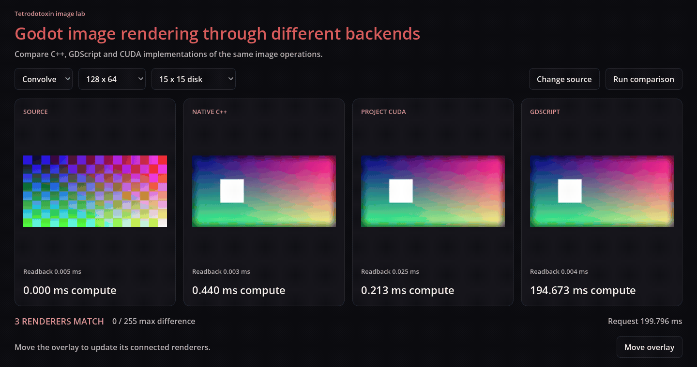

# TTX for Godot

TTX for Godot loads independently built modules and exposes their graph
contracts to GDScript. Providers use the TTX SDK and keep their implementation
separate from Godot. The extension discovers declarations it can represent and
leaves unsupported declarations available through their original graphs.

The SDK contains the GDExtension and its runtime dependencies. It ships no C++
headers. Configure `ttx/modules` with the provider libraries a project uses;
feature overrides select the corresponding libraries for an export.

## Image lab

The [example project](example/project.godot) composes native C++, GDScript and
project-authored CUDA image operations. Each provider controls its storage and
execution. The scene compares their results and demonstrates selective updates:
changing an overlay reuses the filtered image, while changing the source updates
the connected pipeline.

[Try the browser demo](https://tetrodotoxin.dev/lab/). Web uses the CPU and
GDScript providers; CUDA requires a compatible native driver.

[](https://tetrodotoxin.dev/lab/)

## Build

Install Bazel, Python 3 and Godot 4.7 or later. Bazel acquires the pinned SDKs
and compiler dependencies.

```sh
bazel build :sdk --config=release
bazel run :tests
```

The SDK archive is `.bin/bin/source/godot/godot-ttx-sdk.zip`. Extract it into a
Godot project. The image lab is a separate package:

```sh
tools/run.sh --cpu
```

`source/godot/` owns the extension. `source/demo/` owns the independent native
examples and the lab's Godot adapters. `example/` contains the ordinary Godot
project; its scene and scripts are not part of the SDK. `tools/export.py` builds
a Web export using a matching extension-enabled Godot template.

The public contracts remain in TTX. The bridge uses Describe for metadata,
Type for declarations and representations, and Callable for ordered arguments
and invocation. A successful Godot class publication requires complete supported
bindings and retained provider access.
